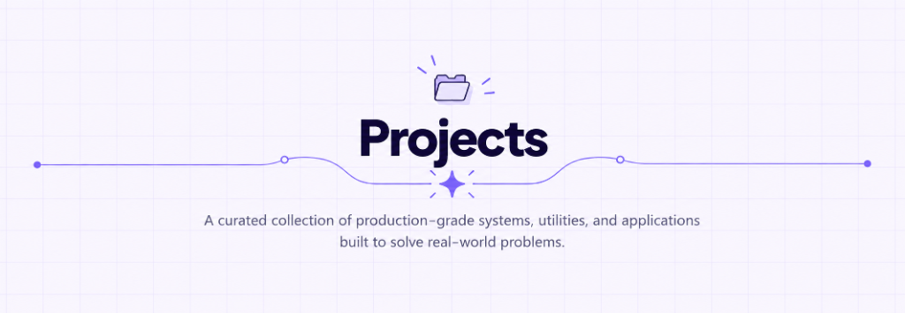

# Section Title & Separator Design Standard (Inspiration Reference)

> **Official Visual Reference:** [`images/design_inspiration_section_title.png`](../images/design_inspiration_section_title.png)  
> This document and image serve as the permanent design inspiration and evaluation benchmark for all section title headers across the portfolio.

---

## 1. Visual Anatomy & Design Specs



The design consists of 4 tightly integrated elements (no icon above title):

```
                     Projects          <-- Bold heading (Space Grotesk / 800 weight)

   •───────○                           ○───────•   <-- Baseline level (vertical center of text)
            \                         /
             \                       /
              ╰─────── ✦ ───────────╯  <-- Cradle dip with 4-pointed sparkle (✦) & spark rays

            A curated collection of production-grade systems...  <-- Subtitle
```

### 1.1 Components & Dimensions
1. **Section Title (`.section-title`)**:
   - Centered typography, bold weight (`800`), font `Space Grotesk` or `Plus Jakarta Sans`.
   - Dark contrast navy/slate color (`#0f172a` / `#302951`).
   - Clean, without any icon on top.

2. **Engineered Separator Line (`.section-title-separator-svg`)**:
   - **Horizontal Baseline**: Aligned with the vertical lower-middle / baseline of the title text.
   - **Outer Terminal Dots**: Filled purple circle (`radius: 4px`, color `#6366f1`).
   - **Straight Lateral Wings**: Horizontal purple stroke (`stroke-width: 1.75px`, color `#818cf8` / `#6366f1`).
   - **Framing Rings**: Hollow circles (`radius: 4.5px`, `border: 2px solid #6366f1`, `background: #ffffff`).
   - **Cradle Dip**: Smooth cubic bezier S-curve swooping down underneath the title text to cradle the sparkle.
   - **Center Sparkle (`✦`)**: 4-pointed diamond star (`path: M 0,-10 Q 0,0 10,0 Q 0,0 0,10 Q 0,0 -10,0 Q 0,0 0,-10 Z`) with 4 radiating 45-degree spark rays.

3. **Section Subtitle (`.section-subtitle`)**:
   - Positioned cleanly below the curved cradle and sparkle.
   - Neutral slate tone (`#334155`), readable, centered.

---

## 2. Animation Specification (Sequential Viewport Reveal)

When the section scrolls into view (triggered via `IntersectionObserver`):

1. **Step 1 - Title Reveal**:
   - Title text fades and slides up smoothly (`opacity: 0 → 1`, `y: 18 → 0`, `ease: power2.out`).

2. **Step 2 - Center Sparkle Ignition**:
   - The 4-pointed sparkle `✦` at the base of the dip bursts into view with slight rotation (`scale: 0 → 1`, `rotation: -45deg → 0deg`, `ease: back.out(2.5)`).
   - Sparkle rays pulse outward.

3. **Step 3 - Symmetrical Line Draw**:
   - The SVG path draws outwards symmetrically from the center cradle under the title:
     - Left branch swoops up through the left hollow ring and shoots horizontally to the left terminal dot.
     - Right branch swoops up through the right hollow ring and shoots horizontally to the right terminal dot.
   - When the paths reach the hollow rings (`○`), the rings pop open (`scale: 0 → 1`, `ease: back.out(2)`).
   - When the paths hit the terminal ends, the solid dots (`•`) pop in.

4. **Step 4 - Subtitle Entry**:
   - Subtitle text fades in with a gentle rise (`opacity: 0 → 1`, `y: 12 → 0`).

---

## 3. Evaluation Checklist for Future Changes

Use this checklist whenever reviewing or modifying section headers:

- [ ] **No Top Icon**: Clean top area without extra floating icons.
- [ ] **Title Hierarchy**: Title centered, prominent, Space Grotesk bold.
- [ ] **Line Alignment**: Lateral straight segments run horizontally at the title's vertical center/baseline.
- [ ] **Cradle Geometry**: Line smoothly dips in a symmetrical cubic bezier curve under the title text.
- [ ] **Center Sparkle**: 4-pointed star `✦` with spark rays sitting in the cradle dip.
- [ ] **Terminal Points**: Hollow ring nodes flanking the title, solid dots capping the outer ends.
- [ ] **Responsive Scaling**: On mobile screens (<640px), straight lateral wings shrink cleanly while the central cradle remains sharp and legible.
- [ ] **Animation Integrity**: GSAP tweens use static values (no dynamic arrow functions per Rule 8 in `AGENTS.md`).
